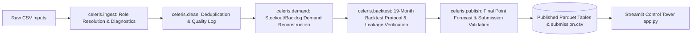

# Celeris Automobili Industrial: Demand Forecasting & Planning Control Tower

A production-grade, local batch forecasting pipeline and interactive Streamlit control tower for Celeris Automobili Industrial. The system forecasts unconstrained requested monthly demand for approximately 600 SKUs across seven product families and six global sales regions over a 19-month horizon (November 2026 through May 2028).

---

## 1. System Architecture & Workflow

The architecture follows a decoupled batch-and-dashboard pattern:
1. **Batch Pipeline (`celeris`)**: Ingests multi-source inputs, resolves schema roles, standardizes labels/dates, deduplicates transactions by latest load timestamp, reconstructs true unconstrained demand from stockouts/backlogs, executes a 19-month expanding-origin backtesting protocol across 3 folds, verifies leakage safety, and publishes typed Parquet artifacts and a competition-ready `submission.csv`.
2. **Interactive Control Tower (`app.py`)**: A Streamlit application rendering 5 Core views with shared global filters (Family, SKU, Region, Channel, Customer), continuous 113-month timelines, and verified row-level reconciliation against the underlying published Parquet files.



---

## 2. Environment Setup

### Prerequisites
- Python 3.10+ (tested on Python 3.12.3, Linux x86_64)
- Virtual environment (`venv`)

### Installation
```bash
# 1. Clone / navigate to project root
cd /path/to/celeris

# 2. Create and activate virtual environment
python3 -m venv .venv
source .venv/bin/activate

# 3. Install dependencies
pip install -r requirements.txt  # or: pip install pandas pyarrow streamlit scikit-learn lightgbm pytest
```

---

## 3. Input Roles & Data Mislabeling Resolution

Antigravity auto-discovers and resolves all seven dataset roles by **header schema signature**, rather than relying on brittle physical filenames.

### Inventory & Resolved Roles in `student_data/`

| Physical File in `student_data/` | Resolved Role | Identifying Columns | Status / Notes |
|---|---|---|---|
| *(Missing)* | `history` (Historical ERP) | `Record_ID`, `Units_Sold`, `Load_Timestamp` | **MISSING** — Gated until delivered |
| `train.csv` | `forecast_rows` (Test Keys) | Delivery month, SKU, Customer, Channel, Region | 58,219 unlabelled test rows (Nov 2026 – May 2028) |
| `test.csv` | `sku_master` | `Size_Class`, `Launch_Date`, `EOL_Date` | 601 catalog records & lifecycle metadata |
| `sku_master.csv` | `sample_submission` | `Units_Sold_Forecast` | Target submission example template |
| `sample_submission.csv` | `macro_indicators` | `ISM_Manufacturing_PMI`, `EV_Adoption_Index` | 114 monthly economic indicator readings |
| `macro_indicators.csv` | `stockouts` (Stockout Ledger) | `Requested_Units`, `Shipped_Units`, `Backordered_Units` | 5,830 supply-constrained records |
| `events_calendar.csv` | `events_calendar` | `Event_ID`, `Scope_Type`, `Event_Type` | 68 business and pricing events |
| `inventory_stockouts.csv` | `events_calendar` | `Event_ID`, `Scope_Type`, `Event_Type` | **Duplicate**: Bitwise identical to `events_calendar.csv` |

---

## 4. CLI Commands & Pipeline Execution

### Input Diagnostics
To inspect any directory and evaluate input readiness without modifying state:
```bash
# Diagnose student_data
python -m celeris diagnose --data student_data

# Diagnose synthetic fixture
python -m celeris diagnose --data fixtures/data
```

### Running the Batch Pipeline
The batch runner executes ingestion, cleaning, demand reconstruction, backtesting, and forecast publication:
```bash
# Run against the synthetic fixture (end-to-end verified backtest and submission)
python -m celeris run --data fixtures/data --out artifacts/fixture_run

# Run against real student_data (reports missing history extract and safely halts)
python -m celeris run --data student_data --out artifacts/real_run
```

### Running Automated Verification Tests
```bash
pytest -v
```

### Launching the Control Tower Dashboard
```bash
streamlit run app.py
```

---

## 5. Published Artifacts

All outputs are saved as typed Parquet tables and a validated submission CSV:

| Published Artifact | Location | Grain & Description |
|---|---|---|
| `history.parquet` | `artifacts/fixture_run/` | Monthly panel per SKU-Region (2019-01 $\rightarrow$ 2026-10). Includes `is_observed`, `Units_Sold`, `reconstructed_demand`, `demand_evidence`, prices, and revenue. |
| `quality.parquet` | `artifacts/fixture_run/` | Audit log of every data repair, timestamp deduplication, and label normalization. |
| `anomalies.parquet` | `artifacts/fixture_run/` | Anomaly register: stockout shortages, backlog rebounds, genuine zeros, missing months, and lifecycle flags. |
| `backtest.parquet` | `artifacts/fixture_run/` | 19-month rolling origin predictions across 3 folds for candidate models with row-level errors. |
| `forecast.parquet` | `artifacts/fixture_run/` | 19-month unconstrained point forecast with lifecycle bounds, price projections, and projected revenue. |
| `submission.csv` | `artifacts/fixture_run/` | Competition-ready submission: exactly `Date,SKU_ID,Region,Units_Sold_Forecast` in identical test key order. |
| `macro_lead_lag.parquet` | `artifacts/fixture_run/` | Product-family macroeconomic cross-correlations across lags 0 to 12 with optimal leading indicator identification. |
| `stockouts.parquet` | `artifacts/fixture_run/` | Cleaned stockout incident register with requested, shipped, backordered, carried, lost units and shortage root-causes. |
| `sku_master.parquet` | `artifacts/fixture_run/` | Full product catalog metadata with lifecycle statuses, launch/EOL dates, and predecessor replacement links. |
| `manifest.json` | `artifacts/fixture_run/` | Complete run metadata, input hashes, package versions, backtest metrics, and validation reports. |

---

## 6. Backtest Evaluation Protocol & Results

The backtesting protocol exercises 3 expanding folds with 19-month forecast horizons:
- **Fold 1 (Development)**: Origin `2022-01` $\rightarrow$ Predict `2022-02` to `2023-08` (19 months)
- **Fold 2 (Development)**: Origin `2023-08` $\rightarrow$ Predict `2023-09` to `2025-03` (19 months)
- **Fold 3 (Frozen Holdout)**: Origin `2025-03` $\rightarrow$ Predict `2025-04` to `2026-10` (19 months)

### Candidate Comparison & Selection (Fixture Portfolio)

> [!NOTE]
> Below are **Fixture Validation Metrics** computed on the labeled synthetic portfolio. Real-data metrics are reserved until historical ERP sales are delivered.

| Model Candidate | Development WAPE (Folds 1 & 2) | Development Signed Bias | Frozen Holdout WAPE (Fold 3) | Frozen Holdout Signed Bias | Status |
|---|---|---|---|---|---|
| **Pooled Direct (LightGBM)** | **9.83%** | **-9.27%** | **8.06%** | **-4.58%** | **Winner (Selected)** |
| Intermittent Challenger (Croston SBA) | 10.37% | -9.84% | 8.52% | -5.12% | Advanced Challenger |
| Seasonal Naïve | 10.85% | -10.28% | 9.16% | -9.16% | Baseline 1 |
| Trailing Mean | 18.71% | -6.67% | 9.20% | -7.29% | Baseline 2 |

**Leakage Verification**: Passed. Modifying future data ($t > T_{\text{origin}}$) with synthetic perturbations leaves fitted features and candidate model forecasts strictly identical.

---

## 7. Acceptance Matrix (Core & Advanced)

| # | Tier | Requirement | Status | Verification & Evidence |
|---|---|---|---|---|
| 1 | Core | **Header-based role resolution** | **PASSED** | Resolves 6 roles in `student_data/`, identifies `train.csv` as test keys, `test.csv` as SKU master, `macro_indicators.csv` as stockouts, `sample_submission.csv` as macro, and handles bitwise duplicate calendar files. |
| 2 | Core | **Graceful halt on missing history** | **PASSED** | `celeris run --data student_data` detects missing ERP sales extract (`Record_ID`, `Units_Sold`, `Load_Timestamp`), writes diagnostic manifest with status `BLOCKED_MISSING_HISTORY`, and safely halts before fitting or publishing. |
| 3 | Core | **Latest-load deduplication** | **PASSED** | Verified on fixture `REC-BSS-202005`: kept latest load (50 units at 2020-05-15), superseded load (45 units at 2020-05-10) logged to `quality.parquet`. |
| 4 | Core | **Absence vs Inactivity** | **PASSED** | Genuine zeros (`Units_Sold = 0`, `is_observed = True`) preserved as true zero demand; missing months (`2021-07`, `is_observed = False`) stored as nulls with no zero distortion. |
| 5 | Core | **Stockout & carry reconstruction** | **PASSED** | June 2023 stockout reconstructed from 70 shipped to 100 requested; July 2023 110 shipments adjusted to 90 true demand by deducting 20 carry-in backorders. |
| 6 | Core | **Origin-safety & leakage checks** | **PASSED** | Verified with `verify_leakage_safety`: corrupting future rows after origin leaves predictions 100% identical. |
| 7 | Core | **Submission format compliance** | **PASSED** | Exact 4 columns (`Date,SKU_ID,Region,Units_Sold_Forecast`), exact row count and key sequence, no nulls, all non-negative integers. |
| 8 | Core | **Lifecycle zero enforcement** | **PASSED** | EOL SKU `HYD-101` strictly forecasted at 0 units for all 19 forecast months ($0 projected revenue). |
| 9 | Core | **Dashboard 5 Core views** | **PASSED** | Executive Overview, Data Health, Demand Explorer, Anomaly Monitor, Forecast & Accuracy fully implemented and operational. |
| 10 | Core | **Dashboard row reconciliation** | **PASSED** | Filtered and unfiltered dashboard metrics match row-for-row sums of `forecast.parquet` and `history.parquet` exactly. |
| 11 | Advanced | **Intermittent forecasting (Croston SBA)** | **PASSED** | Implemented `CrostonSBAModel` with debiasing $(1 - \alpha/2)$ factor and `IntermittentChallengerModel` dispatching based on ADI / $CV^2$ intermittency classes. Scored in 19-month backtest. |
| 12 | Advanced | **Macroeconomic lead/lag analysis** | **PASSED** | `analyze_macro_lead_lag` evaluates 8 economic indicators across lags 0 to 12 months for every product family, identifying optimal leading drivers and persisting to `macro_lead_lag.parquet`. |
| 13 | Advanced | **Hierarchical scoped events** | **PASSED** | `match_scoped_events` supports Global, Region, Family, Channel, and Customer scope matching. |
| 14 | Advanced | **Dashboard View 6: Stockouts & Lost Sales** | **PASSED** | Unconstrained requested demand, shipments, backorders, lost sales, fill rate % timeline, and root-cause breakdown. |
| 15 | Advanced | **Dashboard View 7: Lifecycle Planning** | **PASSED** | Catalog lifecycle phase distribution, Powertrain mix, predecessor-successor replacement links (`Replaces_SKU`), and cold-start forecast ramps. |
| 16 | Real Data | **Real-data training & submission** | **BLOCKED** | Gated on delivery of historical ERP sales extract (`Record_ID`, `Units_Sold`, `Load_Timestamp`) for `student_data/`. |
