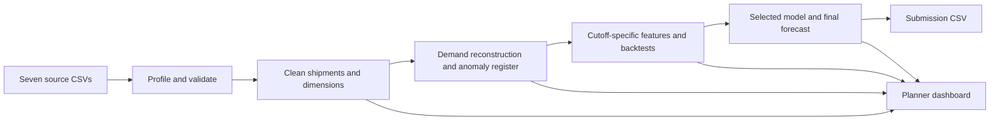

# Celeris demand forecasting and planning control tower

## Outcome and scope

A planner selecting a product family should be able to follow its monthly shipments through October 2026, see how stockouts changed the estimate of customer requests, and inspect the forecast through May 2028. A manager should see the same figures roll up to the company total. The submission CSV and the dashboard both read the same published forecast.

The planning scope is approximately 600 SKUs across seven product families and six regions. The one-week Core release covers cleaning, anomaly detection, demand-driver analysis, predictive models and an interactive planner dashboard. Advanced and Expert capabilities follow the working Core release. Portfolio size, expected row counts, periods and business rules come from the [corrected problem statement](../../../Celeris_Demand_Forecasting_Problem_Statement_corrected.md).

## Input inventory

**Implementation handoff.** Start with Core. Use the linked problem statement for the full column definitions and business rules. Implement the batch command and its output tables first, then connect all five dashboard views to those outputs. With the historical extract missing, run the same code end to end on a small, explicitly selected fixture covering the backtest dates, with a few SKUs and known outcomes. Label fixture runs in the manifest and dashboard and write them to a separate output directory. A real-data run with a missing role should identify the role and expected columns and exit before training or publishing. Once all inputs are available, run the real-data acceptance checks below. Document the local environment setup, input directory, batch, dashboard and test commands in the project README.

The seven CSV files in `student_data/` cover six of the seven expected dataset roles. Two headers match the events calendar. The historical ERP sales extract is still missing. This inventory is based on headers alone. Row counts, date coverage and SKU counts are checks for the implementation run.

| Dataset role | File in this checkout | Identifying columns |
|---|---|---|
| Historical ERP sales | Missing | `Record_ID`, `Units_Sold`, `Load_Timestamp` |
| Rows to forecast | `train.csv` | Delivery month, SKU, customer, channel and region with no target column |
| SKU master | `test.csv` | `Launch_Date`, `EOL_Date`, `Replaces_SKU` |
| Submission example | `sku_master.csv` | `Units_Sold_Forecast` |
| Macro indicators | `sample_submission.csv` | `ISM_Manufacturing_PMI`, `EV_Adoption_Index` |
| Stockout ledger | `macro_indicators.csv` | `Requested_Units`, `Carried_In_Units`, `Shipped_Units` |
| Events calendar | `events_calendar.csv` and `inventory_stockouts.csv` | Both contain `Event_ID`, `Scope_Type` and `Event_Type`. Row equivalence is unverified. |

At startup, match headers against the seven schemas in the brief, using the full column set to distinguish history from forecast inputs. Record each physical path and resolved role in the run manifest. Report missing or ambiguous roles before fitting. This mapping also handles a later delivery under the expected filenames. Training and backtests depend on the historical ERP extract. The stockout ledger samples constrained months and cannot represent ordinary orders, zero months or portfolio demand.

## Approaches

| Approach | Benefit | Trade-off |
|---|---|---|
| Notebook-led analysis with a dashboard export | Fastest way to inspect unusual ERP records | Repeating repairs across backtests and keeping dashboard exports in sync takes extra care |
| Local Python batch pipeline with a Streamlit dashboard **(proposed)** | One set of cleaning and forecasting rules supports validation, submission and drill-down | Requires explicit intermediate tables and a publish step |

Use pandas for tabular processing, Parquet for typed local artifacts, and a pooled gradient-boosted tree model for the main challenger. A laptop runs the batch jobs. Streamlit reads their outputs and filters them locally. A live ERP connection, online model serving and automated purchase orders are outside the one-week scope.

## Implementation architecture

Run two local processes. The Python batch command owns data preparation, model fitting, validation and publication. The Streamlit app opens one published run and applies planner filters to its tables. Changing a dashboard filter reads and aggregates saved results without triggering a training job.

| Proposed location | Responsibility |
|---|---|
| `celeris/__main__.py` and `celeris/pipeline.py` | Parse the run arguments and coordinate ingestion, historical backtests, final fitting and publication. Pass each forecast origin explicitly to the stages that depend on time. |
| `celeris/ingest.py` and `celeris/clean.py` | Resolve CSV roles, validate keys, normalize fields and return cleaned tables plus the data-quality log. |
| `celeris/demand.py` and `celeris/features.py` | Reconcile shipments and stockouts, produce the anomaly register, and build model inputs using data available at each origin. |
| `celeris/forecast.py` and `celeris/backtest.py` | Implement the candidate models and fallbacks. Use the same feature and prediction functions for historical folds and for the final 19-month forecast. Store predictions and scoring targets by fold. |
| `celeris/publish.py` | Validate output tables, derive the submission from the final forecast table, and publish the tables and manifest as one run. |
| `app.py` | Load the published run, maintain shared filter selections and render the five Core views. Compute filtered totals and accuracy from the saved rows. |
| `tests/` | Exercise cleaning rules, forecast cutoffs and submission contracts. Run the batch command on the labeled fixture and check that the dashboard can load its outputs. |

### Data flow and contracts

Treat requested delivery month, SKU and region as the planning key. Preserve source row identifiers through cleaning. Take forecast keys and their customer and channel assignments from the file resolved as rows to forecast. The submission example supplies the output schema. Building a Cartesian product of SKUs, regions and months would create orders for combinations outside the test set.

| Published artifact | Grain and contents |
|---|---|
| `history.parquet` | One row per planning key in the historical panel. Includes observed-row flag, cleaned shipped units, reconstructed demand, demand evidence, observed revenue, price, customer, channel and lifecycle. Unobserved quantities remain nullable. |
| `quality.parquet`, `anomalies.parquet` | File, source row or planning key, field, rule, original and cleaned values, decision, reason and linked evidence. An anomaly also carries type, date range, confidence and action. |
| `backtest.parquet` | Origin, target month, horizon, planning key, dimensions, candidate, forecast, evaluation target and evidence. Retain row-level errors to recompute metrics after filtering. |
| `forecast.parquet` | One row per test key with dimensions, horizon, final integer point forecast, price assumption, projected revenue, model or fallback and, when qualified, P10/P50/P90. |
| `forecast_paths.parquet` (Expert) | Run, draw ID, test key and simulated demand. The dashboard sums the selected leaves within each draw before computing quantiles, including for cross-filtered selections. |
| `submission.csv` | Exactly `Date,SKU_ID,Region,Units_Sold_Forecast`, in test row order, with a non-negative integer for every row. |

The proposed entry points are `python -m celeris run --data student_data --out artifacts` and `streamlit run app.py`. With all roles resolved, the batch command profiles the inputs, builds dated folds, refits through October 2026, validates and publishes. Write a new run to a staging directory, then switch the current-run pointer after validation. Store input hashes, configuration, package versions, seed, fold dates, coverage and rule counts in its manifest. The app reads one run per session so a failed or concurrent rebuild cannot mix versions.

## Cleaning and reconstructing demand

1. **Establish identity and time.** Preserve raw fields. Parse delivery dates to months and derive year and month from them. Normalize recognized label variants with an auditable mapping. For repeated `Record_ID`, keep the latest valid load and log superseded rows. Quarantine conflicting ties or ambiguous identities. For distinct IDs sharing a planning key, sum only substantiated separate lines and preserve their revenue and attribution. Flag unresolved collisions. If multiple customers or channels legitimately share a key, retain their contributions in a detail table for dashboard filtering and reconcile them to the planning total.
2. **Reconcile quantities and prices.** Derive a reference price from reliable same-SKU transactions across regions within each pricing year, adjusted for documented surcharges. Compare units × price to revenue with a currency-rounding tolerance. Repair a scale or currency error only when independent evidence identifies the affected field and factor. Preserve genuine January price changes. Conflicting evidence produces a flagged unknown for the affected measure. Check master family, BU, launch, predecessor and EOL against transaction history, recording contradictions for review.
3. **Distinguish absence from inactivity.** Build a monthly index for each observed or requested SKU-region over its relevant life. Track true zero orders, missing records, months outside the SKU lifecycle and months before regional trading separately. A missing record contributes neither a zero target nor a known order-cycle observation. Launch and EOL months are inclusive. Future rows outside that interval receive zero and a reason. Keep contradictory historical rows visible for audit.
4. **Validate the reference files.** Enforce key uniqueness in the master and stockout ledger. Check event intervals, event scope values, predecessor links and missing or conflicting macro months. Standardize indicator units, deduplicate agreeing readings and flag implausible jumps. Use a bounded, past-only carry-forward for short indicator gaps, initially one month, with a missingness flag. Longer gaps remain unknown. Publish issue counts and examples for every file, including test and sample.
5. **Reconstruct requested units.** Check ledger shipments against cleaned shipments and verify `requested + carried_in = shipped + backordered + lost`. For a reconciled ledger row, use `Requested_Units` as the demand target. For a following month without a ledger row, subtract validated prior-month backorders from observed shipments when the carry can be attributed and no new shortage is indicated. Record this as an estimate. Missing shipment records, negative residuals or contradictory ledgers require review. On ordinary observed months use cleaned shipments as a demand proxy. Flag suspected unlisted shortages from scoped supply events and shipment/rebound evidence. Keep uncertain estimates available to planners and exclude unresolved targets from fitting and primary scoring.

For example, suppose customers request 100 units in June. With zero carried in, 70 ship, 20 are backordered and 10 are lost. July ships 110 units including the confirmed carry of 20. The dashboard shows shipments of 70 and 110 and requested demand of 100 and an estimated 90. Assigning all 110 to new July orders would teach the model a rebound that came from the backlog.

## Anomalies and forecast drivers

Run deterministic checks first. On valid observations, compare demand with a seasonal or ordering-cycle baseline using trailing residuals and a robust spread estimate. Use a family-region fallback for short series. Tune alert thresholds on development history and record the settings. The register distinguishes a repaired error, retained business event, reconstructed shortage and unresolved observation. Preserve the original point for every action.

| Pattern | Evidence and planner action |
|---|---|
| Large order or sustained level change | Compare nearby seasonal peers and successive observed cycles. Keep real shipments. Flag a one-off for robust fitting or mark the start of a new regime. |
| Early buying or holiday | Inspect the paired rise and dip around a dated price change or scoped holiday. Retain both months and add a timing feature where the pattern repeats. |
| Account switch, loss or cycle change | Compare customer assignments, inter-order intervals and observed zero runs before and after the change. Respect missing records. Show suspected loss with its evidence and update the regime only when supported. |
| Stockout or lifecycle conflict | Link the ledger, event or master row to the affected series. Show the chosen target, correction evidence and any unresolved conflict. |

Core features cover delivery month, seasonality, lags at 1, 3, 6 and 12 months, trailing mean and variability, time since last order, observed zero share, inter-order interval and variability of positive order sizes. Calculate them as of each origin. Train successive examples with their own as-of state. Carry missingness flags through to the model.

For the Core intermittency class, compute average demand interval as eligible observed months divided by positive-demand months. Compute squared coefficient of variation as the population variance of positive order sizes divided by their squared mean. As an initial rule, split these measures at 1.32 and 0.49 respectively. Label the four combinations smooth (both low), intermittent (high interval only), erratic (high variability only) and lumpy (both high). Treat values at the thresholds as high. Mark series with fewer than two positive months as insufficient history. Store the class and observation counts per origin and expose them in the demand explorer.

Advanced features include series age, distance to launch/EOL, scoped event overlaps, customer changes and lagged macro indicators. Match global, region, family, channel and customer events to their stated scope, including customer–region pairs. Clip open-ended events at the prediction month. Separate demand events from system incidents and supply-only constraints. In development folds, compare indicator lags 0–12 against family demand after removing trend and seasonality. Retain drivers that improve held-out forecasts. Compare early and late windows and examine EV adoption separately for ICE, EV and universal applications. Label these as associations.

## Forecasting and validation

Predict monthly **unconstrained requested units**. The submission field keeps the organizer’s name. Fit on eligible reconstructed demand across SKU-regions and forecast every supplied row, including newly launched products and the new region.

| Candidate | Definition and role |
|---|---|
| Seasonal naïve | Use the same delivery month in the most recent available seasonal cycle as of origin. Repeat that cycle for long horizons. |
| Trailing mean | Average the last six calendar months of eligible demand, including observed zeros. A missing month contributes no observation. |
| Pooled direct model | Train one boosted tree regressor on historical origin–target pairs with horizon 1–19 as a feature. Combine origin-frozen history with target-month calendar and known covariates. Sharing data supports short series and avoids recursive lag feedback. |
| Intermittent challenger | Compare a bias-adjusted Croston forecast on sporadic series. Use time since order and cycle phase in the pooled model to capture timing that an average rate misses. |

For absent baseline inputs or a cold start, first use a valid predecessor’s demand in the same region, aligned to seasonal month and historical replacement ramps where supported. Otherwise use comparable products in family, application and region at the same lifecycle age, widening to family and then portfolio peers as needed. Use demand per active series, not aggregate family volume. Estimate new-region scaling only from information known by the origin. Record the fallback level and support count. Keep unresolved peer scarcity visible. Apply lifecycle bounds before export, clip negative predictions to zero, and round the leaf point forecast once. All point totals sum those integers.

**Backtest protocol.** Use expanding history with three full 19-month windows. Train through January 2022 and predict February 2022–August 2023. Train through August 2023 and predict September 2023–March 2025. Train through March 2025 and predict April 2025–October 2026. Use the first two windows for feature, model and fallback choices. Freeze them before scoring the last window. Each fold repeats the data-dependent cleaning, feature fitting and model training. Outcomes and ledger corrections from the fold’s future are available only to its scorer.

Populate historical future-covariate features only with what could be known at the origin. Use published forecast-window macro values for the final run. For backtests without archived macro forecasts, project beyond-origin indicators using origin-known values and report the assumption. Mask future account switches, event announcements and lifecycle status changes whose advance availability cannot be established. Use the explicit assignments and known calendar supplied for the final test. If load timestamps describe retrospective bulk exports, document vintage uncertainty and label the exercise a retrospective backtest.

Compute WAPE as `sum(abs(forecast - actual)) / sum(actual)` and signed bias as `sum(forecast - actual) / sum(actual)`. Positive bias means overforecasting. Recompute from leaf rows by family, region and horizon. For a zero denominator display N/A, absolute unit error and support. Report scored rows, excluded unknowns and shares of confirmed versus proxy demand. Compare full-coverage candidate policies on identical development rows. For the intermittent challenger, use Croston on series classified as sporadic at origin and the pooled model elsewhere. Select the policy with the lowest development WAPE, using absolute bias and simplicity to break close calls. Keep a baseline if it wins. Show the frozen holdout result against both baselines, even if accuracy degrades.

**Expert ranges.** Calibrate empirical forecast errors by horizon and demand class using development-fold out-of-sample predictions, pooling sparse classes. Generate nonnegative demand paths by sampling whole contemporaneous error vectors across leaves where support permits, preserving common shocks. Apply lifecycle constraints to each path and sum it through SKU, family, BU, region and company views. Derive P10/P50/P90 from the resulting distribution at the displayed aggregation. Adding leaf P90s would overstate the portfolio’s P90. The point forecast remains additive at every level. Check interval ordering, observed 80% band coverage, width and support on the frozen holdout. Suppress unsupported ranges with a reason. Refit and update calibration with all available out-of-sample errors for the final run.

## Planner dashboard

One local app has **Training data** and **Prediction** sections with persistent family, SKU, region, channel and customer filters. Filter rows using their month-specific assignments before aggregating. A continuous date axis shows January 2019–May 2028, a boundary after October 2026, solid historical series and a distinct forecast line. Preserve gaps for unknown months. Label shipped units, requested demand, estimates and dollars explicitly.

| View | What the planner sees or can decide |
|---|---|
| Executive overview, both sections | A headline 19-month unit and projected-revenue total, monthly units and revenue spanning history and forecast, and mix by family, region and channel. |
| Data health, training | Issue counts by source and rule, distinct affected rows, unresolved cases and before/after examples with row identifiers. |
| Demand explorer, training | Drill from family to SKU, region and customer. Inspect seasonality, order intervals, zero and missing months, launch/EOL and reconstructed demand alongside shipments. |
| Anomaly monitor, training | Select a flagged point on the series and see its type, reason, action and supporting record or event. |
| Forecast & accuracy, prediction | View the forecast beside history and available ranges. Inspect fold-specific WAPE, signed bias, unit error and coverage by family, region and horizon. Select a backtest origin to compare predicted and realized demand. |

Historical revenue sums cleaned booked sales. Forecast revenue equals final forecast units × projected SKU price. Carry the last reliable base price forward and apply documented future price changes or surcharges for their effective months. For unpriced launches use a predecessor or comparable family/size price, disclose its basis and coverage, and label remaining unknown revenue as unpriced. Never silently count unpriced units as zero dollars.

The first two optional views are **stockouts and lost sales** (requested, shipped, carried and lost units) and **lifecycle** (launches, EOL, predecessor and forecast). The next two are a **macro lead/lag heatmap** with lag stability and a **planner exception list** ranked by units exposed, with links to the affected series. These reuse the same outputs and filters.

## One-week delivery and acceptance

Start with schema resolution and forecast-key validation. During reference-data checks, compare the two calendar inputs by event ID and fields. Count identical events once and flag conflicts for review. While the ERP extract is outstanding, use a labeled fixture to exercise deduplication, stockout carry and missing months. Once history arrives, run the full pipeline and acceptance checks on the supplied data. Core is the one-week acceptance target. Additional tiers depend on the available team and time.

| Day | Work and exit check |
|---|---|
| 1 | Profile all inputs. Confirm key cardinalities, date coverage and reconciliation examples. Produce a machine-readable issue report. |
| 2 | Publish cleaned history, ledger reconciliation and anomaly register. Trace an order, a zero, a missing row and a corrected shortage through the pipeline. |
| 3 | Run both baselines and the pooled model on development folds. Materialize backtest rows and a first complete submission. |
| 4 | Connect all five Core views. Compare a filtered dashboard total with its underlying rows and run the pipeline from raw files on a clean checkout. |
| 5 | Add intermittent methods, scoped events, lifecycle fallbacks and the first two optional views. Compare development results and freeze model choices. |
| 6 | Score the untouched last fold. Check range coverage, aggregate coherence, cold starts and the other two optional views as time permits. |
| 7 | Refit on full history, regenerate the submission, rerun acceptance checks and document local setup, assumptions, holdout accuracy and limitations. |

The Core release requires the following checks. Advanced and Expert results are reported only for features exercised on supplied data.

- Verify the submission has exactly the four specified columns, identical key sequence and multiplicity to the test file, 19 forecast months, no blanks and only non-negative integer forecasts. The brief expects 58,219 rows. Surface a discrepancy against the actual file before release. Validate zero sales outside permitted lifecycle dates.
- Exercise duplicate reloads, authoritative dates, uncertain corrections, stockout carry, genuine zeros, missing months, event scope and cold starts with small fixtures. Assert every join preserves its intended grain. Report unresolved inputs and their impact.
- Perturb outcomes after a fold origin. Its fitted features and predictions must remain identical. Score candidates on the same eligible keys, verify WAPE and bias against hand-calculated examples, and record each fallback.
- From a fresh local run, open every required view, change each shared filter, and trace one SKU-region from raw records to cleaned demand, validation forecast, final CSV and executive total. Verify observed and projected revenue labels and forecast boundary.
- For Expert delivery, reconcile every point total to its leaves, check interval ordering and coverage, and demonstrate four optional views. Data gaps, assumed prices and unsupported intervals must be visible at the point where a planner uses them.
